# Factory

How features and bugs flow through this repo: submitted as issues, designed by grilling, implemented test-first, reviewed by parallel sub-agents, verified on the physical test bench, and shipped as a PR with documentation, specs, and ADRs.

This document is the lifecycle source of truth. The skills in `skills/` are the executable form of each stage; when they disagree, fix the skill.

## Lifecycle

The feature lifecycle: from a filed issue to a merge-ready PR, with a user confirmation gate at every stage boundary.

```mermaid
%%{init: {"theme":"neutral","themeVariables":{"primaryColor":"#4a90d9","primaryBorderColor":"#2c6a9e","primaryTextColor":"#1a1a1a","secondaryColor":"#d9e8f5","tertiaryColor":"#f0f0f0","lineColor":"#999999","clusterBkg":"#f5f5f5","clusterBorder":"#aaaaaa","fontFamily":"monospace","nodeBorder":"#888888","edgeLabelBackground":"#ffffff"}}}%%
graph LR
  A[Feature/bug filed<br/>issue template] --> B[Triage<br/>skills/triage]
  B --> C[Grill<br/>skills/grill-with-docs<br/>→ ADRs + glossary]
  C --> D[Spec<br/>skills/to-spec<br/>→ .scratch/feature/SPEC.md]
  D --> E[Tickets<br/>skills/to-tickets<br/>→ .scratch/feature/issues/]
  E --> F[Implement<br/>skills/implement + tdd]
  F --> G[Review<br/>skills/code-review<br/>5 sub-agent axes]
  G --> H[Device verify<br/>device-verify skill<br/>firmware-facing only]
  H -->|fail| F
  H -->|pass| I[PR<br/>skills/pr]
  I --> J[Merge<br/>user action, CI green]
```



Every stage boundary is a **user confirmation gate**: the agent summarizes what the stage produced and waits before proceeding.

## Bug path

Bugs take a shorter path than features: grill/spec/tickets exist to settle design, and a bug with a known fix has no design to settle.

| Step | Skill | Note |
|---|---|---|
| Triage | `triage` | Claim verification is the red loop: reproduce from the reporter's steps before anything else |
| Diagnose | `diagnosing-bugs` | Only if no tight red loop exists yet; ends with a minimised repro and ranked hypotheses |
| Implement | `implement` + `tdd` | Regression test at the correct seam before the fix; no ticket files for small fixes |
| Review | `code-review` | Same five axes; the Spec axis checks the fix against the triage claim, not a spec |
| Device verify | `device-verify` | Same firmware-facing gate |
| PR | `pr` | Evidence carries the red loop's before/after |

Grill/spec/tickets become mandatory for a bug when the fix is itself a design decision (new seam, protocol change, invariant change) — the user decides at the triage gate. A bug with no repro after diagnosis goes back to `needs-info` or becomes a feature.

## Stages

| Stage | Skill | Produces | Tracker label |
|---|---|---|---|
| Intake | — (issue templates in `.github/ISSUE_TEMPLATE/`) | A structured issue | `needs-triage` |
| Triage | `triage` | Category + state, verified claim, agent brief | `accepted` (or `needs-info` / terminal) |
| Grill | `grill-with-docs` | Settled design tree; ADRs in `docs/adr/`; `docs/GLOSSARY.md` updates | — |
| Spec | `to-spec` | `.scratch/<feature>/SPEC.md`; affected `docs/spec/` modules identified | — |
| Tickets | `to-tickets` | `.scratch/<feature>/issues/NN-*.md` with blocking edges | `ready-for-agent` |
| Implement | `implement` + `tdd` | Working code + tests at agreed seams; module specs updated | `in-progress` |
| Review | `code-review` | Five-axis findings (Standards / Security / Spec / Invariants / Performance), resolved or accepted | — |
| Device verify | `device-verify` (local managed skill) | Test-bench evidence posted to the issue | `needs-device-verify` |
| PR | `pr` | PR against `develop` with summary, evidence, merge danger, device verification | labels cleared on merge |

## Verification gauntlet

The checks that must be green before a PR, as they apply:

| Check | Command | When |
|---|---|---|
| Unit + simulation tests | `make test -j4` | Always |
| Full suite incl. startup integration | `make integration-test -j4` | Always (locally; excluded from CI by design) |
| Pipeline tests | `make pytest` | `scripts/ha_discovery/` changed |
| Generated-file sync | `make check-generated` | ERD definitions, overrides, or pipeline scripts changed (rerun the pipeline and commit all generated files together) |
| Real ESPHome build | `esphome compile docs/test-compile.yaml` | `components/geappliances_bridge/` changed |
| Device verification | `device-verify` skill | Diff touches `components/` or `lib/` |
| TLA+ model check | CI (TLC over `formal/`) | Concurrency-core `docs/spec/` module changed (cache, publisher, write bridge, startup HSM); model and spec commit together (ADR-0003) |

CI (`.github/workflows/`) runs `make test` and the pipeline pytest on every push/PR, and the ESPHome compile on pushes to `main`/`develop`; the full integration suite is local-only by design (CppUTest `TestMemoryAllocator` false positives on CI). Device verification is a manual, in-session loop — it needs the physical test bench and the tailnet, which CI runners don't have.

## Device verification gate

A change is **firmware-facing** iff its diff touches `components/` or `lib/`. Firmware-facing changes require test-bench evidence (MQTT topics observed, values, logs, benchmark numbers) posted to the issue before the PR opens. Non-firmware-facing changes (pipeline, docs, CI, scripts) are exempt; the PR body records the exemption and its reason.

Every firmware build is benchmarked against the **`develop` baseline**: the five canary metrics (loop time, min heap, ERDs in cache, ERD publish rate, MQTT publish rate — `docs/GLOSSARY.md`) plus flash/RAM, read from the device's debug sensors. A movement against the baseline is a performance bug, not a note.

The test bench and its details (device, wiring, HA access, MQTT credentials) are workstation-local and live in the `device-verify` managed skill, not in this repo.

## Definition of done

A feature is done when ALL hold:

- Every acceptance criterion in the spec and tickets is met.
- The verification gauntlet is green (as applicable).
- Code review is clean on all five axes, or findings are explicitly accepted by the user.
- Device verification evidence is posted (firmware-facing) or the exemption is recorded.
- Affected `docs/spec/` module specs are updated (specs are the single source of truth for module contracts).
- ADRs exist for hard decisions; `docs/GLOSSARY.md` is current.
- The PR is open against `develop` with the full `pr`-skill body.

Merging is the user's action, never the agent's.

## Working agreements

- **Branching:** one branch per feature/issue, from `develop`; work happens on the fork, PRs target `develop` on the canonical repo.
- **Never merge, never force-push** without explicit user instruction; no `Co-Authored-By:` trailers.
- **Facts vs decisions:** the agent looks up facts (code, git history, issues) and puts decisions to the user. An agent that answers its own decisions has broken the process.
- **Glossary discipline:** code, specs, issues, PRs, and ADRs use the terms in `docs/GLOSSARY.md`. When code and glossary disagree, the code wins — fix the glossary.
- **Generated files** are never hand-edited; the pipeline reruns and commits atomically with the change that caused them.
- **Feature records:** `.scratch/<feature>/` is committed on the feature branch and lands on `develop` with the PR — the durable trail. After merge, move it to `.scratch/archive/` so the active list stays clean.
- **Formal models** in `formal/` are never hand-edited out of sync with their module spec: model and spec commit together (ADR-0003).

## Setup (one-time, per workstation)

```bash
# 1. Link the repo skills into the agent skill directories
#    (OMP: .omp/skills, Claude Code: .claude/skills)
bash scripts/factory/setup_skills.sh

# 2. Create the triage labels on the canonical repo (owner account only)
bash scripts/factory/setup.sh
```

The skills are agent-agnostic markdown: OMP and Claude Code load them as skills; GitHub Copilot follows them from the `Software Factory` section of `.github/copilot-instructions.md`. The `device-verify` skill is a local managed skill (workstation-specific; the test bench doesn't travel with the repo).

## Provenance

The stage skills adapt the discipline from [mattpocock/skills](https://github.com/mattpocock/skills) (grilling, triage, to-spec, to-tickets, implement, code-review, tdd, diagnosing-bugs, pr, domain-modeling), rebound to this repo's conventions: CppUTest + simulation doubles, `docs/spec/` module contracts, the five-axis review, and the physical test-bench gate. `factory` and `device-verify` are original to this repo.
